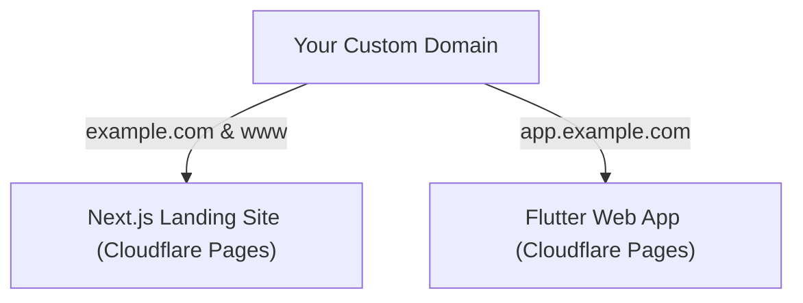

# Deploying L'Carnet B2B to Cloudflare Pages with Custom Domain

Cloudflare Pages provides **unlimited bandwidth**, zero build-timeout issues for Flutter (via GitHub Actions), instant global CDN, and automated free SSL for your custom domain.

---

## Architecture Overview

| Component | Target URL | How it's built & deployed |
| :--- | :--- | :--- |
| **Landing Page** | `yourdomain.com` / `www` | Cloudflare Pages Git connection (`lcarnet-b2b-landing/out`) |
| **Flutter Web App** | `app.yourdomain.com` | GitHub Actions workflow compiles Flutter & pushes to Cloudflare Pages |

---

## Step 1: Add Your Domain to Cloudflare (Free DNS & SSL)

1. Sign up or log into [Cloudflare](https://dash.cloudflare.com/).
2. Click **“Add a Site”** (or **“Add Domain”**) and enter your domain name (e.g. `yourdomain.com`).
3. Select the **Free Plan** ($0/month).
4. Cloudflare will scan existing DNS records. Click **Continue**.
5. Cloudflare will show you **2 Nameservers** (e.g. `ada.ns.cloudflare.com` and `bob.ns.cloudflare.com`).
6. Go to the registrar where you bought your domain (Namecheap, GoDaddy, Hostinger, OVH, etc.):
   - Find **Nameservers / DNS Settings**.
   - Change from “Default” to **Custom Nameservers**.
   - Paste the 2 Cloudflare nameservers and save.

*(DNS propagation usually takes 5 to 15 minutes).*

---

## Step 2: Deploy the Next.js Landing Site (`yourdomain.com`)

Your Next.js project in [`lcarnet-b2b-landing/`](file:///c:/Users/leets/Desktop/moul-sel3a-1/lcarnet-b2b-landing) is already configured for static export (`output: "export"` in `next.config.ts`), which is natively supported by Cloudflare Pages.

1. In the Cloudflare dashboard, navigate to **Compute (Workers & Pages)** → **Pages** → **Connect to Git**.
2. Select your GitHub account and choose the repository `omorakwant/moul-sel3a`.
3. Configure the build settings:
   - **Project name**: `lcarnet-landing` (or any name you like)
   - **Production branch**: `main`
   - **Framework preset**: `Next.js (Static Export)`
   - **Root directory**: `lcarnet-b2b-landing`
   - **Build command**: `npm run build`
   - **Build output directory**: `out`
4. Click **Save and Deploy**. Cloudflare will build and give you a free URL (e.g. `lcarnet-landing.pages.dev`).
5. **Attach your Custom Domain**:
   - In the project, go to **Custom domains** → **Set up a custom domain**.
   - Enter `yourdomain.com` (and repeat for `www.yourdomain.com`).
   - Cloudflare will automatically add the DNS records and provision an SSL certificate.

---

## Step 3: Deploy the Flutter Web App (`app.yourdomain.com`)

Because Flutter compilation requires the Flutter SDK, we use **GitHub Actions** to build the app and push the release to Cloudflare Pages.

### 3.1 Create Cloudflare Pages Project for the App
1. In Cloudflare dashboard: **Compute (Workers & Pages)** → **Create application** → **Pages** → **Direct Upload**.
2. Name the project: `lcarnet-app`.
3. Click **Create project** (you don't need to upload files manually now).

### 3.2 Get Cloudflare API Credentials
1. **Account ID**:
   - In Cloudflare dashboard, look at the right sidebar of your dashboard or URL (32-character hex string).
2. **API Token**:
   - Go to **My Profile** (top right) → **API Tokens** → **Create Token**.
   - Select the template **“Cloudflare Pages”** (or create a custom token with **Account > Cloudflare Pages > Edit** permissions).
   - Click **Create Token** and copy the token.

### 3.3 Add Secrets to GitHub
1. Go to your GitHub repository: **Settings** → **Secrets and variables** → **Actions**.
2. Click **New repository secret** and add:
   - `CLOUDFLARE_ACCOUNT_ID`: Your Cloudflare Account ID.
   - `CLOUDFLARE_API_TOKEN`: The API Token you created.

### 3.4 Deploy via GitHub Actions
The workflow file [`.github/workflows/deploy-cloudflare.yml`](file:///c:/Users/leets/Desktop/moul-sel3a-1/.github/workflows/deploy-cloudflare.yml) is already created.
- Every push to `main` modifying files in [`app/`](file:///c:/Users/leets/Desktop/moul-sel3a-1/app) will trigger the build automatically.
- You can also run it manually from the **Actions** tab in GitHub by clicking **Run workflow**.

### 3.5 Attach Subdomain to Flutter App
1. In Cloudflare dashboard → **Workers & Pages** → `lcarnet-app` → **Custom domains**.
2. Click **Set up a custom domain** and enter `app.yourdomain.com`.
3. Cloudflare automatically routes traffic and provisions SSL.

---

## Summary of URLs

| URL | What Users See |
| :--- | :--- |
| `https://yourdomain.com` | Next.js Landing Site (Marketing, Features, Onboarding) |
| `https://www.yourdomain.com` | Redirects to root domain or landing site |
| `https://app.yourdomain.com` | Live Flutter Web App (Hanout Ledger, Supplier/Retailer) |
